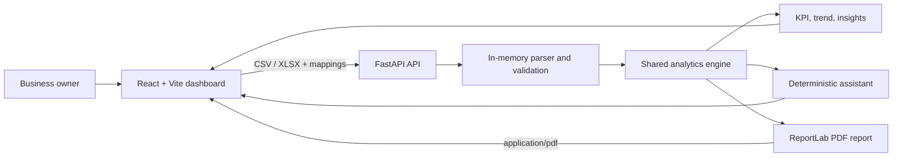

# Business Insight Studio

Business Insight Studio is a local-first business analytics MVP for exploring sales and operational data. Upload a CSV or Excel workbook, confirm its column mappings, and review calculated KPIs, trends, data-grounded insights, deterministic assistant answers, and a downloadable PDF report.

Uploads are sent to the configured FastAPI service for each operation and processed in memory. The app does not persist uploaded datasets or send them to an external AI service.

## Features and workflow

- CSV and XLSX upload, validation, bounded preview, and data-quality warnings.
- Category-aware column mapping for retail, e-commerce, restaurants, manufacturing, marketing, and logistics.
- KPI cards, trends, segment breakdowns, deterministic insights, and evidence-based suggested actions.
- A deterministic Business Data Assistant that explains unsupported questions or missing mapped data.
- A PDF report generated from the same backend analytics result used by the dashboard.
- Responsive React interface, accessible controls, and local API health status.

Select a business category → upload a dataset → confirm mappings and aggregation → inspect the dashboard → ask dataset questions or download the report.

## Architecture and data flow



## Technology

- Frontend: React 18, TypeScript, Vite, Lucide icons, SVG-based charts.
- Backend: Python, FastAPI, Uvicorn, openpyxl, ReportLab.
- Tests: pytest / FastAPI TestClient; Node's built-in test runner for frontend formatting.

## Project layout

```text
E:\B_I_S\
├── backend\
│   ├── app\              # API, parsing, analytics, assistant, PDF generation
│   ├── tests\            # API, analytics, upload, assistant, and report tests
│   ├── requirements.txt
│   └── .env.example
├── frontend\
│   ├── src\              # React app, workflow UI, charts, API client
│   ├── tests\            # Frontend utility tests
│   ├── package.json
│   └── .env.example
├── Start_BIS.bat         # Opens the local backend and frontend terminals
└── README.md
```

## Prerequisites and Windows setup

Install Node.js with npm and Python 3.13. The existing launcher expects the backend virtual environment at `backend\.venv`, installed backend requirements, frontend `node_modules`, and `frontend\.env`. Setup does not install or download an AI model.

From PowerShell:

```powershell
Set-Location E:\B_I_S\backend
py -3.13 -m venv .venv
.\.venv\Scripts\python.exe -m pip install -r requirements.txt
if (-not (Test-Path .env)) { Copy-Item .env.example .env }

Set-Location E:\B_I_S\frontend
npm.cmd ci
if (-not (Test-Path .env)) { Copy-Item .env.example .env }
```

The backend environment uses `BIS_ALLOWED_ORIGINS=http://127.0.0.1:5173,http://localhost:5173` and a 20 MiB upload cap by default. The frontend `.env` uses `VITE_API_BASE_URL=http://127.0.0.1:8000`. Restart Vite after changing its environment file. Do not put secrets in either frontend environment file; Vite variables are included in browser code.

## Start and stop

From `E:\B_I_S`, run:

```powershell
.\Start_BIS.bat
```

This opens separate backend and frontend terminal windows. Visit `http://127.0.0.1:5173`. Stop each server with `Ctrl+C` in its terminal window.

Manual startup is also supported in separate PowerShell terminals:

```powershell
# Backend
Set-Location E:\B_I_S\backend
.\.venv\Scripts\python.exe -m uvicorn app.main:app --host 127.0.0.1 --port 8000 --reload
```

```powershell
# Frontend
Set-Location E:\B_I_S\frontend
npm.cmd run dev -- --host 127.0.0.1 --strictPort
```

The backend health check is `http://127.0.0.1:8000/api/health`; interactive API documentation is at `http://127.0.0.1:8000/docs`.

## API endpoints

All upload endpoints accept multipart form data. Uploaded file size defaults to 20 MiB; only CSV and XLSX extensions are accepted.

| Method and path | Purpose |
|---|---|
| `GET /api/health` | Service health status. |
| `GET /api/categories` | Categories and semantic mapping fields. |
| `POST /api/preview` | Parse an upload and return bounded sample rows, inferred types, counts, and warnings. |
| `POST /api/analyze` | Return KPI metrics, trends, breakdowns, insights, recommendations, and quality details. |
| `POST /api/assistant` | Answer a supported question using the uploaded file and current mappings; no external AI. |
| `POST /api/report` | Return an `application/pdf` attachment generated from the active upload and mappings. |

`/api/analyze`, `/api/assistant`, and `/api/report` accept `file`, `category`, `mappings` (JSON object), `range` (`all`, `30`, or `90`), and `aggregation` (`row` or `order`). The assistant also requires `question` (maximum 500 characters). Errors use HTTP `413` for oversized files, `415` for unsupported file types, and `422` for invalid input or data.

## KPI definitions

Calculations are performed in `backend\app\analytics.py` and reused by the dashboard, insights, assistant, and PDF generator.

- **Revenue / sales:** Sum of valid values in the mapped amount field. In order-total mode, repeated order totals are counted once when order IDs and totals are consistent.
- **Cost:** Sum of the mapped cost values. A column clearly named as unit cost is multiplied by mapped quantity. Unconfirmed cost granularity in order-total mode is reported as unavailable.
- **Profit:** Revenue minus compatible mapped cost, using records where both values are valid. A separate mapped profit column is not used as a substitute for cost.
- **Profit margin:** Profit divided by revenue times 100; unavailable when revenue is zero or compatible inputs are missing.
- **Orders / shipments:** Distinct valid identifiers only when the corresponding ID column is mapped. Unmapped order counts, returns, and discounts remain unavailable.
- **Monthly change:** Compares adjacent, fully comparable months with valid dates and amount values. Missing or non-adjacent periods do not produce a growth figure.
- **Marketing and logistics KPIs:** Use their category-specific mapped fields and show unavailable values when the necessary fields are absent or invalid.

Compact values are for display. Detailed values and report data retain the calculations' exact numeric values.

## Testing

```powershell
Set-Location E:\B_I_S\backend
.\.venv\Scripts\python.exe -m pytest -q

Set-Location E:\B_I_S\frontend
npm.cmd run build
npm.cmd run test:format
```

## Screenshots

- Dashboard: *Placeholder — add a screenshot captured from the running application.*
- Upload and column mapping: *Placeholder — add a screenshot captured from the running application.*
- PDF report: *Placeholder — add a screenshot of a generated report.*

## Deployment readiness and limitations

The app is prepared for a separately hosted static frontend and FastAPI service, but is not deployed or configured with a hosting provider. Build the frontend with its production `VITE_API_BASE_URL` set to the HTTPS API origin. Set backend `BIS_ALLOWED_ORIGINS` to a comma-separated allowlist of the exact HTTPS frontend origins; local Vite origins on port 5173 remain supported. The backend rejects wildcard origins and non-local HTTP origins. A hosting platform may require Uvicorn to bind to `0.0.0.0` and use its assigned `PORT`; do this only in the hosting service configuration, not the local launcher.

The service has no accounts, authorization, database, persistent file storage, rate limiting, or hosted deployment configuration. Production use requires an authenticated deployment and operational controls appropriate to private business data. API calls re-upload the selected file for each analysis, assistant answer, or report. No external AI model or service is connected.

Potential future improvements (not implemented) include authenticated workspaces, opt-in persistent datasets, background processing for larger uploads, and automated deployment checks.
